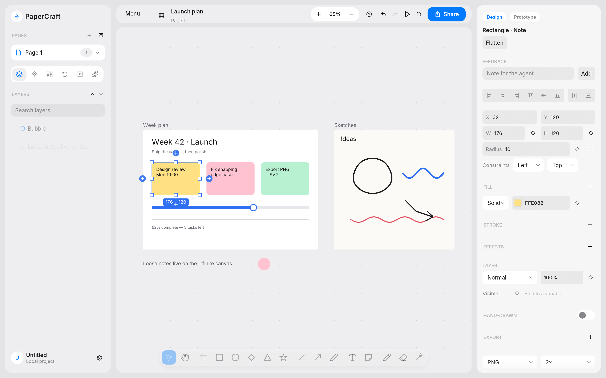
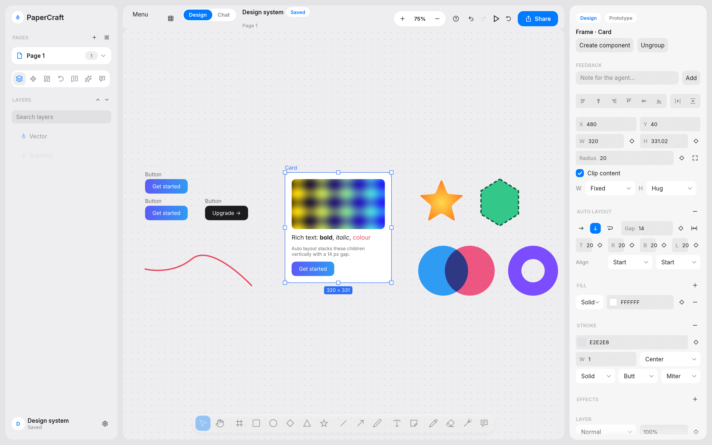
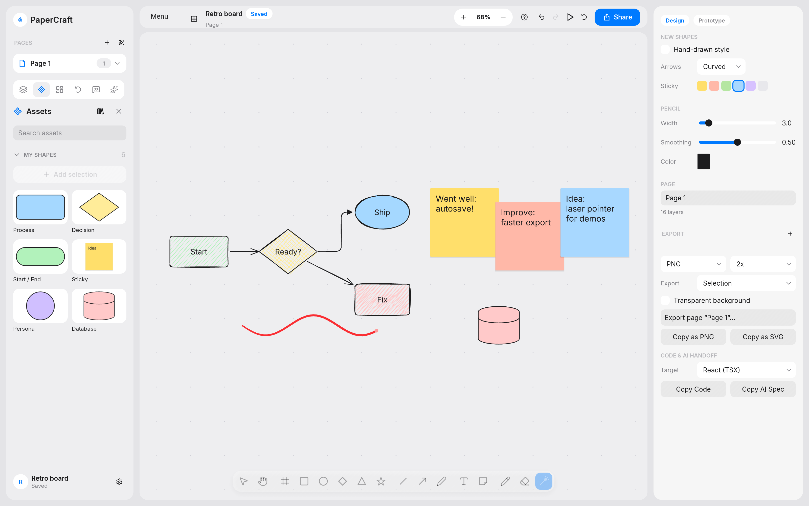
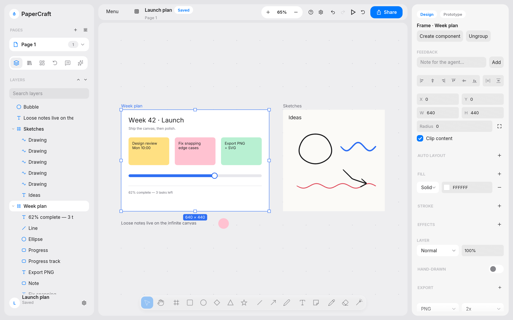
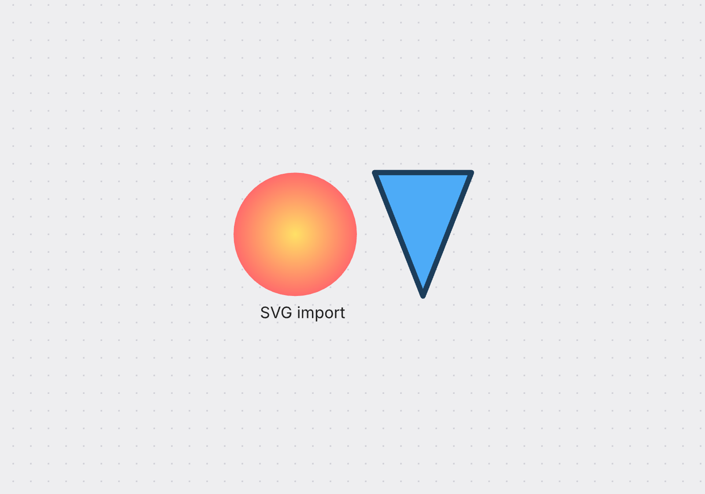
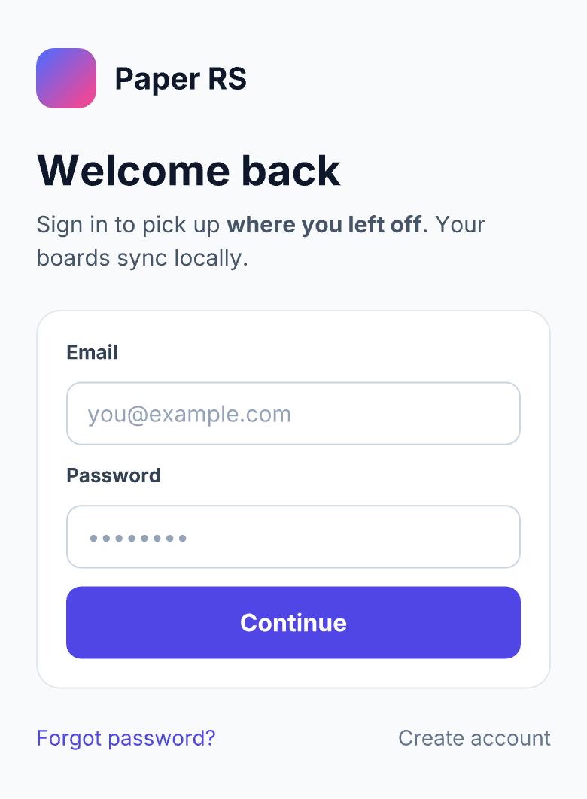
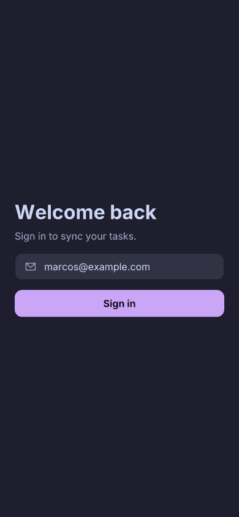
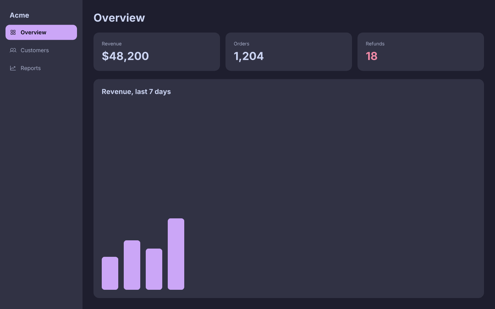
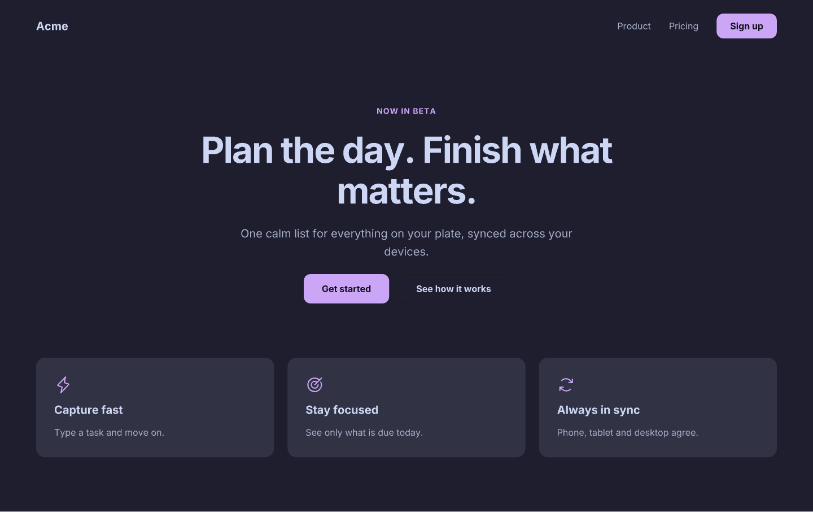

<h1 align="center">PaperCraft</h1>

<p align="center">
  <b>Design and whiteboarding on an infinite canvas; a native, local-first, agent-driven design tool, built in pure Rust.</b>
</p>

<p align="center">
  Frames, auto layout, components, variables and icons, plus a hand-drawn whiteboard mode,<br>
  in a native app written entirely in Rust. Open source, offline, and drivable by AI agents.
</p>

<p align="center">
  
  
  
  
  
</p>

<br>

<p align="center">
  
  <br>
  <sub>A planning board: frames, sticky notes, a progress bar, hand-drawn sketches, the Layers panel and the Design inspector.</sub>
</p>

<p align="center">
  <a href="#features">Features</a> ·
  <a href="#drive-it-with-agents">Agents</a> ·
  <a href="#design-systems-variables-components-icons">Design systems</a> ·
  <a href="#get-started">Get started</a> ·
  <a href="#keyboard-shortcuts">Shortcuts</a> ·
  <a href="#status">Status</a> ·
  <a href="#downloads">Downloads</a> ·
  <a href="#license-and-credits">License</a>
</p>

<br>

<table>
  <tr>
    <td width="25%" valign="top">
      <h3>Local-first</h3>
      Projects are plain folders of JSON in <code>~/Documents/papercraft</code>. Autosave with atomic writes, no account, no cloud.
    </td>
    <td width="25%" valign="top">
      <h3>Native and fast</h3>
      egui on wgpu (Metal, Vulkan, DX12). No Electron, no web view. Cached tessellation: a frame with 10k visible nodes draws in about 3 ms.
    </td>
    <td width="25%" valign="top">
      <h3>Design and whiteboard</h3>
      Auto layout, components and variables next to hand-drawn shapes, bound arrows, sticky notes and a laser pointer, on the same canvas.
    </td>
    <td width="25%" valign="top">
      <h3>Agent-ready</h3>
      40 MCP tools and a shell CLI. Agents write HTML into layers, screenshot the result and lint it, one undo step per call.
    </td>
  </tr>
</table>

<br>

## Features

<table>
  <tr>
    <td width="50%" valign="top">
      
      <br>
      <h3>Design tools</h3>
      Frames with clipping, groups, components with instances and per-property overrides, auto layout (direction, gap, padding, hug, fill, wrap, space-between), constraints, the Pen with Bézier editing, boolean operations, gradients, image fills, strokes, per-corner radii, opacity and blend modes, rich text, smart guides and measurements, align and distribute.
    </td>
    <td width="50%" valign="top">
      
      <br>
      <h3>A whiteboard that sketches</h3>
      Hand-drawn (rough.js-style) rectangles, ellipses, diamonds and lines, arrows that bind to shapes and re-route when they move, elbow connectors, sticky notes, freehand ink with pressure, a laser pointer and a shape library.
    </td>
  </tr>
  <tr>
    <td width="50%" valign="top">
      
      <br>
      <h3>Inspector, layers and a palette</h3>
      A sectioned inspector, a layers tree you can drag to reorder or re-parent, 100+ keyboard shortcuts, and a command palette over every action, page and layer (⌘K).
    </td>
    <td width="50%" valign="top">
      
      <br>
      <h3>Import and export</h3>
      Export a selection, each frame, a page or the whole project to PNG (1 to 4x), SVG or vector PDF. Import <code>.excalidraw</code> scenes and libraries, SVG and images; paste between pages, projects and apps.
    </td>
  </tr>
</table>

### Themes

System, Light, Dark and the four Catppuccin flavours: Latte, Frappé, Macchiato and Mocha. Pick one in **View › Theme** or search "theme" in the ⌘K palette.

### Projects and pages

PaperCraft opens on a **home screen** of your projects (recents grid with thumbnails; New, Import, and Rename, Duplicate or Move to Trash from each card's ⋯ menu or right-click; restore from Trash). A project is a folder in `~/Documents/papercraft/<name>/` with `project.json` and one JSON file per page in `pages/`. Work autosaves about a second after each change with crash-safe atomic writes; files are versioned and older versions migrate on load. Set `PAPERCRAFT_HOME` to use another folder. If you used the app under its earlier name, `~/Documents/paper-rs` is still read when it is the only one that exists.

Each project has any number of **pages** (the Pages list at the top of the left sidebar: + to add, double-click to rename, right-click to duplicate or delete, drag to reorder). Each page is its own infinite canvas with its own undo history and view. Copy and paste works between pages and projects.

### File formats

| Format | Use |
|---|---|
| Project folder (`project.json` + `pages/*.json`) | The native format. Plain, versioned JSON. |
| `.papercraft` | A single-file document (`papercraft FILE.papercraft`, not autosaved). `--import` turns it into a project. |
| `.paper-rs` | The earlier single-file extension. Old files still open. |
| PNG, SVG, PDF | Export: selection, frames, page or all pages. PDF is vector, with gradients, images and blend modes. |
| `.excalidraw`, `.excalidrawlib`, SVG, images | Import (drag and drop, ⌘O, or `--import`). |

## Drive it with agents



PaperCraft serves the [Model Context Protocol](https://modelcontextprotocol.io) while it runs, so agents such as Claude Code and Codex can read and design on the open canvas. Every tool call runs through the editor like a user edit: one undo step per call, and the window repaints immediately. Tool names and arguments follow other design-tool MCP servers where there is an equivalent, so prompts written for them carry over.

<table>
  <tr>
    <td width="33%" valign="top">
      
      <br><sub>A sign-in screen: variables, an icon and a component instance.</sub>
    </td>
    <td width="67%" valign="top">
      
      <br><sub>A dashboard written in one <code>write_html</code> call, then checked with <code>lint_design</code>.</sub>
    </td>
  </tr>
  <tr>
    <td colspan="2" valign="top">
      
      <br><sub>A landing page: hero, call to action and feature cards, all colors from variables.</sub>
    </td>
  </tr>
</table>

* **Streamable HTTP** (built into the app): `http://127.0.0.1:29980/mcp`. Loopback only; requests from browsers (with an `Origin` header) and foreign `Host` headers are rejected. `PAPERCRAFT_MCP_PORT=NNNN` changes the port; `PAPERCRAFT_MCP=0` turns the server off.
* **stdio**: `papercraft-mcp` (built next to `papercraft`) relays stdio to the running app. It lists the tools even when the app is closed, and tells the agent to start PaperCraft if a call can't reach it.
* **Shell**: `papercraft-cli` calls the same tools, so an agent with a terminal needs no schemas in its context.

### Claude Code

```sh
# HTTP (the app must be running)
claude mcp add --transport http --scope user papercraft http://127.0.0.1:29980/mcp
# or stdio through the bridge
claude mcp add --scope user papercraft -- /path/to/papercraft-mcp
```

### Design tab

The sidebar's **Design** tab (next to Layers and Library) lists the project's color variables as
editable swatches, switches variable modes (for example the four Catppuccin flavours), and lists the
page's components with Go to and Insert buttons. Editing a variable recolours every fill that follows it.

### Codex

```sh
codex mcp add papercraft --url http://127.0.0.1:29980/mcp
# or stdio
codex mcp add papercraft -- /path/to/papercraft-mcp
```

which writes this to `~/.codex/config.toml` (either form works):

```toml
[mcp_servers.papercraft]
url = "http://127.0.0.1:29980/mcp"
# command = "/path/to/papercraft-mcp"
```

Then ask the agent something like *"In PaperCraft, create a 390×844 mobile artboard and design a sign-in screen"*, or *"draw a flowchart of our deploy process on a new page, hand-drawn style"*. The [`papercraft` and `papercraft-design` agent skills](skills) teach an agent the workflow (build, screenshot, lint, fix) and design rules; [docs/agents.md](docs/agents.md) has the full guide.

### Shell (no MCP client needed)

The app must be running with a project open.

```sh
papercraft-cli list                          # tool names, one line each (works offline)
papercraft-cli schema write_html             # one tool's full schema
papercraft-cli call get_basic_info
papercraft-cli call create_artboard '{"name":"Hero","styles":{"width":"800px","height":"400px"}}'
echo '{"nodeId":"12"}' | papercraft-cli call get_screenshot - --out hero.png
```

Text goes to stdout, images are saved to `--out` (default `<tool>.png`) and the path is printed, and the exit status is 1 on a tool error or when the app isn't running.

### Tools

| Group | Tools |
|---|---|
| Projects & pages | `list_resources`, `open_file`, `create_file`, `create_page`, `rename_pages` |
| Read | `get_basic_info`, `get_selection`, `get_node_info`, `get_children`, `get_tree_summary`, `get_computed_styles`, `get_jsx`, `find_nodes`, `get_fill_image`, `get_font_family_info`, `get_guide` |
| See | `get_screenshot` (PNG image content of a node or the page), `export` (PNG/SVG/PDF files), `export_combined_pdf` |
| Write | `create_artboard`, `write_html`, `update_styles`, `set_text_content`, `rename_nodes`, `duplicate_nodes`, `move_nodes`, `delete_nodes`, `finish_working_on_nodes` (saves) |
| Whiteboard and session | `create_shape` (rectangles, ellipses, diamonds, stars, stickies, text, lines, arrows bound to shapes), `select_nodes`, `undo`, `redo` |
| Design system | `get_variables`, `set_variables`, `set_variable_mode`, `get_components`, `create_component`, `create_instance`, `search_icons`, `lint_design` |

`write_html` takes HTML with inline styles: flexbox (`display:flex`, direction, gap, padding, alignment, `flex-grow`, wrap) and block stacking map onto auto layout with CSS's stretch rules; text gets size, weight, italic, color, line height, letter spacing, alignment and rich-text runs (`<b>`, `<i>`, `<span style>`); boxes get backgrounds (colors, gradients, images), borders, radii, opacity and blend modes; `` takes local paths or `data:` URIs and `<svg>` is imported as vectors. `update_styles` takes the same CSS as JSON, plus the hand-drawn keys `sketch`, `roughness`, `fillStyle`, `strokeStyle`. Node ids look like `3fa9c1:14` (page and node); `pageId` lets an agent work on another page without switching the user's view. The full reference is in [skills/papercraft/references/tools.md](skills/papercraft/references/tools.md).

## Design systems: variables, components, icons

Agents (and `papercraft-cli`) get the pieces of a design system, so files aren't a pile of hex codes and copies:

```sh
papercraft-cli call set_variables '{"variables":{"surface":"#313244","accent":"#cba6f7"}}'
papercraft-cli call write_html '{"targetNodeId":"root","mode":"insert-children","html":"<div style=\"background:var(--surface)\">…</div>"}'
papercraft-cli call create_component '{"nodeId":"<frame>","name":"Button / Primary"}'
papercraft-cli call create_instance  '{"componentId":"<id>","parentId":"<frame>"}'   # then set_text_content on its layers
papercraft-cli call lint_design '{"nodeId":"<frame>"}'                               # contrast, grid, type scale, names
papercraft-cli icons add phosphor lucide      # open icon sets from npm, with their licences
papercraft-cli icons search arrow left
# in write_html: <x-paper-icon name="phosphor:gear" size="20" color="var(--accent)"/>
```

* **Variables** are named colors per project (`get_variables`, `set_variables`). A fill or text color written as `var(--name)` stays linked; `set_variables` moves every linked fill on every page in one undoable step, and the link is saved in the file. `set_variables` with a `mode` stores one set of values per mode (Light, Dark) and `set_variable_mode` switches the whole project. Strokes and gradients keep fixed colors; fill-based icon sets (Phosphor, Material) follow variables, stroke sets (Lucide) don't.
* **Components** (`create_component`, `create_instance`, `get_components`, `<x-paper-instance>`): edit the main component and every instance follows, except what an instance overrode (text, fills, size, ... are marked automatically when set through `set_text_content` / `update_styles`). Components and their instances live on one page.
* **Icons** live in `<data dir>/papercraft/icons/<set>/` (override with `PAPERCRAFT_ICONS`). Sets: Lucide (ISC), Tabler (MIT), Phosphor (MIT), Heroicons (MIT), Material Symbols (Apache-2.0); each keeps its licence file. `examples/taskflow.py` builds an 8-screen app with all three.
* **Lint** (`lint_design`) checks WCAG contrast, spacing on a 4px grid, the type scale, text under 12px, touch targets under 44px, default layer names and hard-coded colors that should be variables, and says how to fix each.

More in [docs/design-system.md](docs/design-system.md).

## Get started

### Download

The macOS app (`papercraft-<version>-macos-<arch>.dmg`, containing PaperCraft.app) and the command-line tools (`papercraft-cli-<version>-macos-<arch>.zip`, with `papercraft-cli` and `papercraft-mcp`) are attached to each release of [masi/papercraft](https://git.marcospaulo.dev.br/masi/papercraft/releases). Builds are ad-hoc signed and not notarized, so on another Mac open the app with right-click › Open the first time.

### Build from source

You need Rust 1.95 or newer (`rust-version` in `Cargo.toml`). Install it with [rustup](https://rustup.rs).

```sh
cargo build --release
./target/release/papercraft                  # projects home screen
./target/release/papercraft --demo           # sample planning board (not saved)
./target/release/papercraft ~/Documents/papercraft/Plan   # open a project folder
./target/release/papercraft board.papercraft # open a document
packaging/macos/package.sh                   # PaperCraft.app on a DMG, plus the CLI zip (macOS)
```

**macOS:** `xcode-select --install` for the linker, then the commands above. It uses Metal through wgpu. Shortcuts use ⌘, and trackpad pinch zooms.

**Linux:** install the runtime libraries (`sudo apt install libxkbcommon-x11-0 libxcb-xkb1 libvulkan1 mesa-vulkan-drivers` on Debian/Ubuntu), then build. It runs on X11 and Wayland through Vulkan, or GL as a fallback. Shortcuts use Ctrl. File dialogs use the XDG desktop portal.

### Headless (servers, CI)

No display is needed. wgpu renders offscreen, through Mesa lavapipe when there is no GPU:

```sh
papercraft --screenshot ui.png --demo --size 1440x900 --scale 2      # full UI
papercraft --screenshot home.png --home                              # projects home screen
papercraft --export-png out.png PROJECT_DIR --page 0 --scale 2 [--transparent]
papercraft --export-svg out.svg PROJECT_DIR
papercraft --export-pdf out.pdf PROJECT_DIR --frames                 # one PDF page per frame
papercraft --export out_dir PROJECT_DIR --format png --scope frames  # a folder of PNGs
papercraft --import board.excalidraw                                 # new project, prints its folder
```

### Tests

```sh
cargo test                                # unit, scenario, headless GPU and CLI tests
PAPERCRAFT_REQUIRE_GPU=1 cargo test       # fail (instead of skip) when no GPU adapter exists
cargo test --release --test perf -- --nocapture   # 10k-element frame timings
```

The scenario tests drive the editor with synthetic pointer and keyboard events; `tests/mcp.rs` exercises every MCP tool on a headless session, then through an rmcp client over HTTP and through the `papercraft-mcp` stdio bridge. The SVG export is rasterized with resvg and compared with the GPU render.

## Keyboard shortcuts

⌘ on macOS, Ctrl on Linux and Windows. Press `?` or ⌘/ in the app for the full grouped list (100+ bindings), or ⌘K to search every command.

| Keys | Action | Keys | Action |
|---|---|---|---|
| V / 1 | Select | ⌘K | Command palette |
| H, or hold Space | Hand (pan) | ⌘Z / ⌘⇧Z | Undo / redo |
| F or A | Frame | ⌘G / ⌘⇧G | Group / ungroup |
| R / 2, O / 4, D / 3 | Rectangle, ellipse, diamond | ⌘⌥G | Frame selection |
| ⇧Y, ⇧S | Polygon, star | ⌘⌥K / ⌘⌥B | Create component / detach |
| L / 6, ⇧L / 5 | Line, arrow | ⇧A / ⌥⇧A | Add / remove auto layout |
| P, ⇧P / 7 | Pen, pencil | ⌥A ⌥H ⌥D / ⌥W ⌥V ⌥S | Align left/center/right, top/middle/bottom |
| T / 8, S | Text, sticky note | ⌥⇧H / ⌥⇧V | Distribute spacing |
| K | Laser pointer | ⌥⇧U S I E | Union, subtract, intersect, exclude |
| E / 0 | Eraser | ⌘E | Flatten |
| 9, ⌘⇧K | Place image | ⌘B / ⌘I / ⌘U / ⌘⇧X | Bold, italic, underline, strikethrough |
| Enter / ⇧Enter | Edit (text, path) / select parent | ⌘⌥H | Hand-drawn style |
| Tab / ⇧Tab | Next / previous sibling | ⇧H / ⇧V | Flip |
| ⌥-drag | Duplicate while dragging | ⌘⌥C / ⌘⌥V | Copy / paste properties |
| ⌥ hover | Measure distances | ⌘R | Rename |
| ⌘= / ⌘- / ⇧0 | Zoom in / out / 100% | ⇧1 / ⇧2 | Zoom to fit / selection |
| PageUp / PageDown | Previous / next page | ⌘\\ | Show / hide UI |

Draw a frame around existing shapes and it adopts them; shapes drawn inside a frame become its children, and dragging a layer into or out of a frame re-parents it. Hold ⌘/Ctrl while dragging to suspend snapping.

## Status

> [!IMPORTANT]
> **PaperCraft is in early alpha.** It is usable for planning, sketching and building screens, but it is not a replacement for a mature design tool. [ROADMAP.md](ROADMAP.md) lists what is missing, in priority order; [PROGRESS.md](PROGRESS.md) is the milestone history.

Known limits:

* **No rotation.** Nodes are axis-aligned boxes; rotated imports are baked into paths.
* **Text** is Inter only (regular, bold, italic, bold italic) with no shaping: no ligatures, complex scripts or RTL, and no font picker. IME preedit is not displayed (committed text works).
* **Rendering approximations.** Frame clipping is a rectangle, so rounded frames don't clip their corners. Group opacity multiplies into children. Overlay, dodge, burn, light, difference, exclusion and the HSL blend modes draw as Normal on the canvas (they are exact in SVG export).
* **Booleans are destructive**: the result is a new vector path with flattened curves.
* **Variables are colors only** and apply to fills and text color; strokes and gradients keep fixed colors.
* **`write_html`** ignores margin, grid, tables, shadows and transforms (it reports them as `ignoredStyles`). Remote `http(s)` images aren't fetched; pass a local path or a `data:` URI.
* **MCP**: one project is open at a time, so `fileId` must name the open project. Moving or duplicating layers between pages isn't supported.
* **Pen pressure.** winit 0.30 does not expose tablet pressure for pen events that arrive as mouse input, which is common with macOS and Wacom tablets. Otherwise it is simulated from stroke velocity.
* **Linux file dialogs** need an XDG desktop portal. The headless CLI is unaffected.
* **PDF** text is outlined (not selectable).

## Project layout

```
src/geom.rs        vectors, rects, camera
src/vector.rs      bezier paths: flatten, hit test, SVG data, shapes, dashes
src/model/         Node / NodeKind / paints / Document arena
src/history.rs     transactions, undo/redo
src/layout.rs      auto layout, constraints, group bounds
src/ink.rs         stroke smoothing, pressure, outline
src/text.rs        rich text layout and glyph outlines
src/project/       project store, manifest/page formats, migrations
src/session.rs     open project, autosave, thumbnails
src/editor/        tools, structure (groups/components), vector ops, pages, text editing
src/render/        draw ops → cached meshes → wgpu; headless capture
src/io/            PNG, SVG, PDF, export scopes, Excalidraw + SVG import, clipboard
src/mcp/           MCP server (rmcp): tools, HTML/CSS mapping, lint, HTTP service
src/ui/            home screen, pages, layers, inspector, palette
src/bin/           papercraft-cli (shell access) and papercraft-mcp (stdio bridge)
skills/            agent skills: papercraft, papercraft-design
analysis/          behaviour studies and design notes
docs/              guides and headless screenshots produced by `cargo test`
```

## Downloads

| Build | File | Notes |
|---|---|---|
| Windows installer | `papercraft-<ver>-windows-<arch>.msi` | Per-machine installer (WiX) |
| Windows portable | `papercraft-<ver>-windows-<arch>-portable.zip` | `papercraft.exe` + CLI and MCP bridge |
| macOS app | `papercraft-<ver>-macos-<arch>.dmg` | PaperCraft.app, drag to Applications. Ad-hoc signed, not notarized |
| Command-line tools | `papercraft-cli-<ver>-<platform>-<arch>.zip` | `papercraft-cli` and `papercraft-mcp` |

Releases: https://git.marcospaulo.dev.br/masi/papercraft/releases. Other platforms: build from source.

## License and credits

PaperCraft is dual-licensed under [MIT](LICENSE-MIT) or [Apache-2.0](LICENSE-APACHE), at your option.

Bundled fonts, icons and other assets keep their own open licenses; each one is listed with its author, source and license in [ATTRIBUTION.md](ATTRIBUTION.md). Inter (Regular, Medium, SemiBold, Bold and italics) is © The Inter Project Authors under the SIL Open Font License 1.1 (`assets/fonts/OFL.txt`). A few algorithms are ported from MIT-licensed projects (rough.js, hachure-fill, Excalidraw); they are listed with their notices in [THIRD_PARTY.md](THIRD_PARTY.md).

The app icon is original artwork ([`assets/app-icon/`](assets/app-icon/README.md)).

### Reverse-engineered origin

PaperCraft is an independent, clean-room-style reimplementation. It was reverse engineered from [Paper](https://paper.design) by studying the behavior of the Paper desktop app (`analysis/PAPER_ARCHITECTURE.md`) with [REA](https://github.com/morluto/rea) and Claude Code; Figma and Excalidraw were studied from their public docs and, for Excalidraw, its MIT source (`analysis/`). Only *behavior* was studied: no Paper or Figma code, shaders, icons, fonts or assets are used or committed. PaperCraft is not affiliated with, sponsored by or endorsed by Paper or Figma; those names are used only to describe the workflows it is compatible with.

<sub>Photoshop, Illustrator and Adobe are trademarks of Adobe Inc.; Figma is a trademark of Figma, Inc.; Paper is a product of its respective owners. PaperCraft is an independent, open-source project.</sub>
