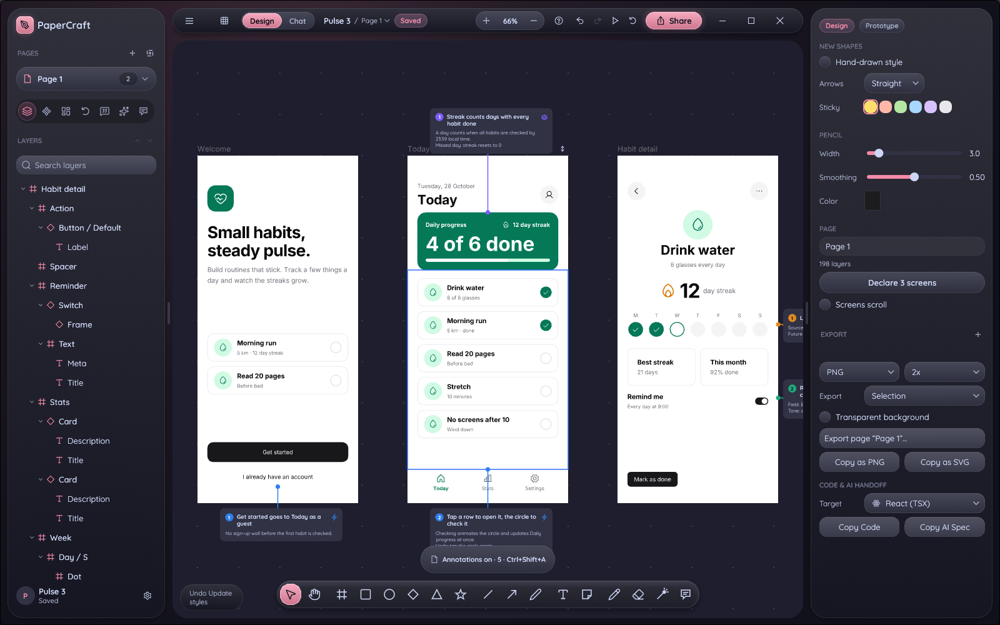
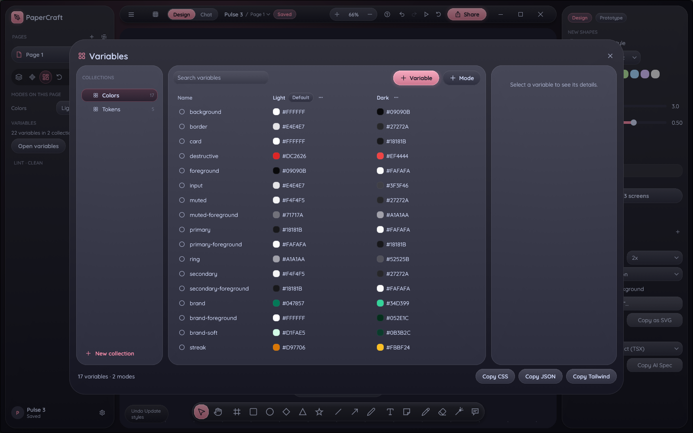
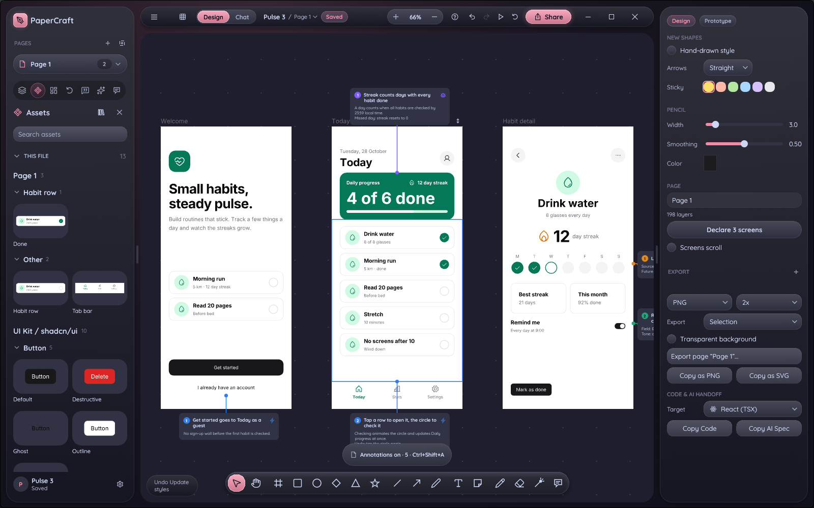
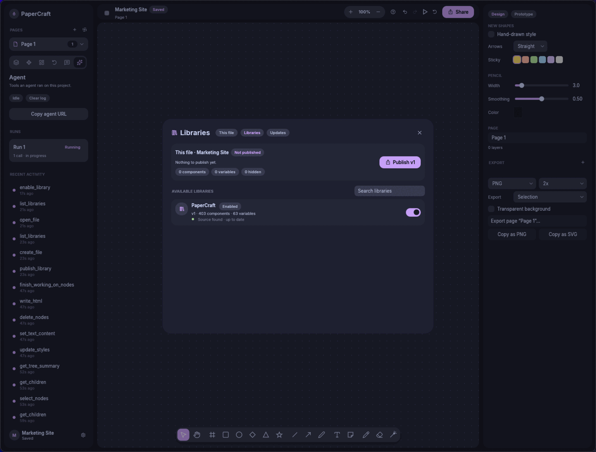
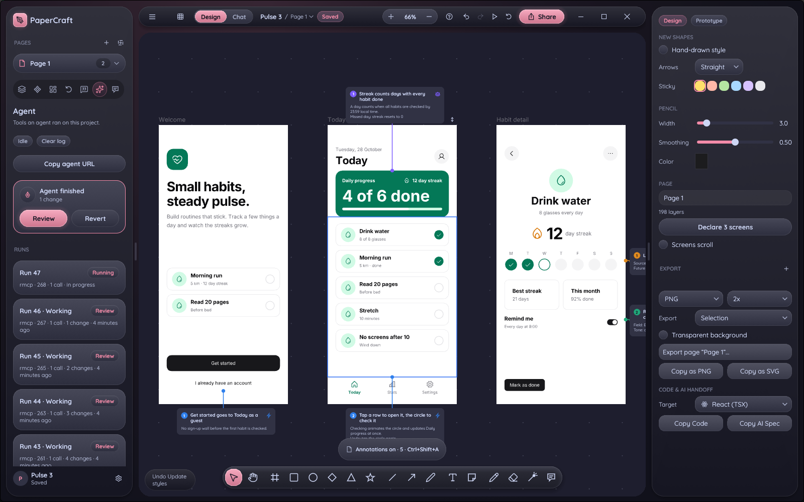
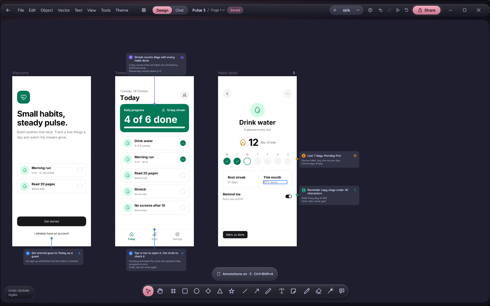
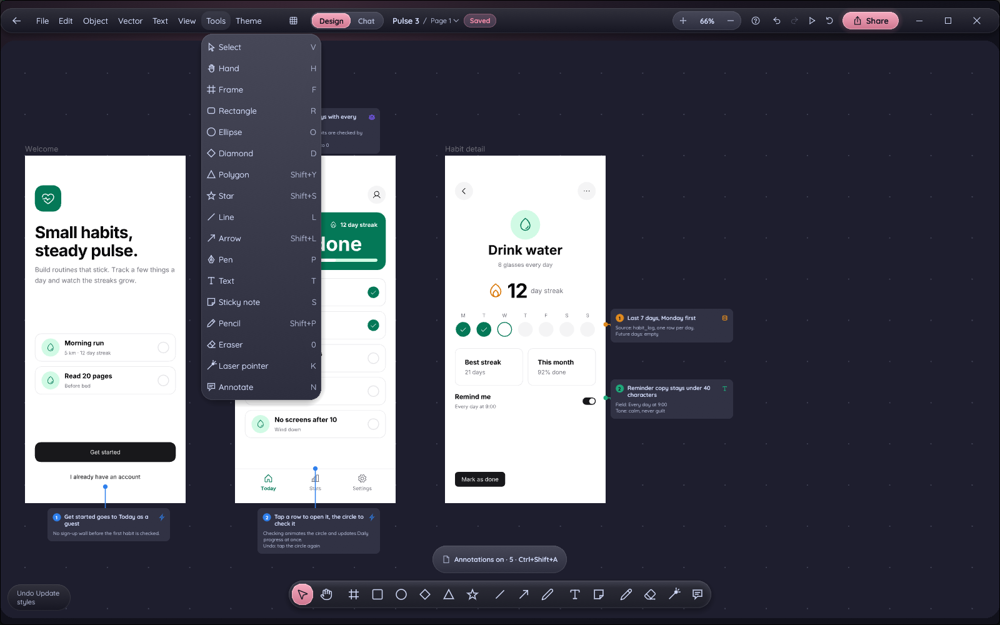
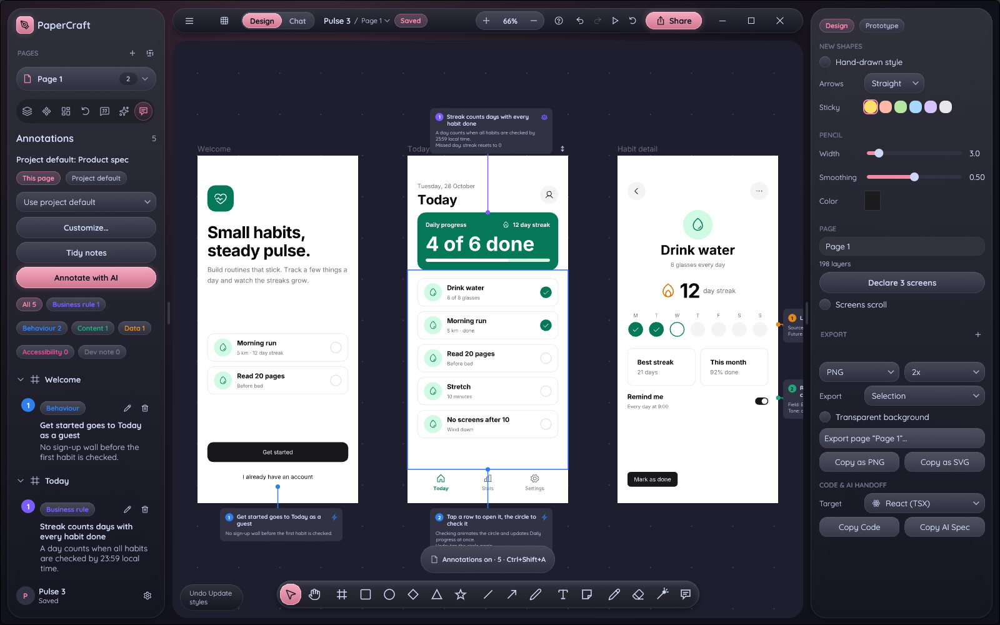
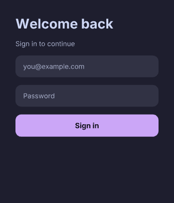
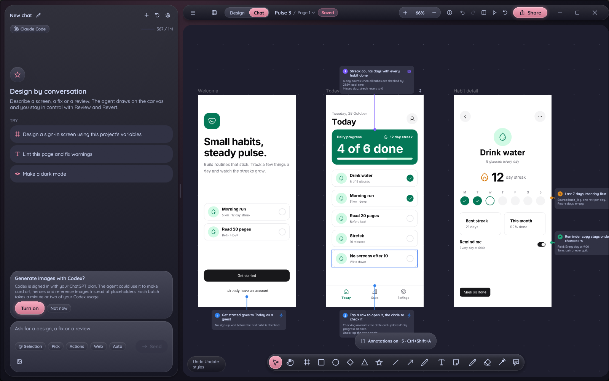

<h1 align="center">PaperCraft</h1>

<p align="center">
  <b>A native, local-first design and whiteboard canvas that AI agents can drive.</b>
</p>

<p align="center">
  
  
  
  
</p>

<p align="center">
  <a href="docs/demo.mp4">
    
  </a>
  <br>
  <sub>A 40-second tour: the editor, chat mode, annotations and design systems. <a href="docs/demo.mp4">Watch it in full quality</a> (MP4, 1080p60). Rendered from the app's own design with <a href="tools/showcase/README.md">tools/showcase</a>, not screen-recorded.</sub>
</p>

<p align="center">
  
  <br>
  <sub>The finished design: three screens, a component library and annotations.</sub>
</p>

<p align="center">
  <a href="#what-it-is">What it is</a> ·
  <a href="#features">Features</a> ·
  <a href="#agents">Agents</a> ·
  <a href="#get-started">Get started</a> ·
  <a href="#keyboard-shortcuts">Shortcuts</a> ·
  <a href="#status-and-known-limits">Status</a> ·
  <a href="#project-layout">Layout</a> ·
  <a href="#license-and-credits">License</a>
</p>

## What it is

PaperCraft is an infinite-canvas design tool and whiteboard written in Rust (egui on wgpu). It runs as a desktop app with no account and no cloud: a project is a folder of JSON files on your disk. It also serves the Model Context Protocol and ships a CLI, so an agent such as Claude Code or Codex can read and edit the open canvas, screenshot the result and lint it, one undo step per tool call.

It is an alpha. It is good for building screens, design systems and sketches, and it is not a replacement for a mature design tool. See [Status and known limits](#status-and-known-limits).

## Features

**Canvas and layout**
* Frames with clipping, groups, vector shapes with the Pen and Bézier editing, boolean operations, gradients, image fills, strokes, per-corner radii, opacity and blend modes, drop shadows, rich text, smart guides, measurements, align and distribute.
* Auto layout (direction, gap, padding, hug, fill, wrap, space-between) and constraints.
* A layers tree you can drag to reorder or re-parent, an inspector with Design and Prototype tabs, and a command palette over every action, page and layer (⌘K).
* Whiteboard mode: hand-drawn (rough.js-style) shapes, arrows bound to shapes, elbow connectors, sticky notes, freehand ink and a laser pointer on the same canvas.
* Pages: each page is its own canvas with its own undo history and view.

**Design systems**
* **Components** work across pages and across projects. Edit a main component and its instances follow, except the properties an instance overrode.
* **Shared libraries:** publish a project as a library, enable it in other projects, and take updates when it changes.
* **Variables:** collections with modes, slash groups (`color/brand/primary`), types (color, number, string, boolean) and aliases. Fills, strokes, text color, size, gap, padding, radius, font size, line height, opacity and visibility bind to variables.
* **Variables modal** (⌘⌥⇧V, or "Variables…" in the palette) to edit all of it; **Assets view** (side tab) with components grouped by name; **Libraries modal** to publish, enable and update.
* Lint (`lint_design`) for contrast, the 4px grid, type scale, touch targets, default names and hard-coded colors, with auto-fix.
* Design tokens out as CSS, JSON (W3C DTCG) or Tailwind `@theme`; code out as JSX with inline styles, Tailwind or HTML.

<table>
  <tr>
    <td width="50%" valign="top">
      
      <br><sub>Variables modal: collections, modes (Light and Dark here), groups and types.</sub>
    </td>
    <td width="50%" valign="top">
      
      <br><sub>Assets view: components grouped by name, from this file and enabled libraries.</sub>
    </td>
  </tr>
  <tr>
    <td width="50%" valign="top">
      
      <br><sub>Libraries modal: publish this file, enable libraries from the store.</sub>
    </td>
    <td width="50%" valign="top">
      
      <br><sub>The Agent view: runs, with Review and Revert for the latest.</sub>
    </td>
  </tr>
</table>

<table>
  <tr>
    <td width="50%" valign="top">
      
      <br><sub>Toolbar and panels: the menu button shows or hides the File / Edit strip, and the slim grip between a panel and the canvas resizes it (double click resets). <kbd>/</kbd> hides both side panels.</sub>
    </td>
    <td width="50%" valign="top">
      
      <br><sub>Menus open a little below their button, are never narrower than 180 px, and carry an icon next to each item.</sub>
    </td>
  </tr>
  <tr>
    <td width="50%" valign="top">
      
      <br><sub>Annotations: rule, behaviour, content and data notes, kept with the layers they describe.</sub>
    </td>
    <td width="50%" valign="top"></td>
  </tr>
</table>

**Prototyping and review**
* Prototype links between frames and a **Present** mode that follows them with a camera glide.
* **Version history:** named and automatic saved versions per page; rename, restore, delete.
* **Agent runs:** editing tool calls group into a run. PaperCraft saves an auto-version before the first edit, lists the run, and lets you review it (added, changed and removed layers, outlined on the canvas), revert one change, revert the whole run or accept it.
* **Comments** on the canvas.

**Sharing and platforms**
* **Shared projects** through an optional relay (`papercraft-relay`); concurrent edits to a page are merged. Without a relay nothing leaves your machine.
* **Themes:** System, Light, Dark and the four Catppuccin flavours (Latte, Frappé, Macchiato, Mocha).
* **Web build** that runs the editor in the browser (`sh web/build.sh`, served by `papercraft-relay --static web`).
* **Import and export:** Figma `.fig` files, `.excalidraw` scenes and libraries, SVG and images in; PNG (1 to 4x), SVG and vector PDF out, for a selection, each frame, a page or the whole project.

Projects live in `~/Documents/papercraft/<name>/` (`project.json`, one JSON file per page in `pages/`, plus `versions/`, `runs/` and library files). Work autosaves with atomic writes and files are versioned and migrated on load. `PAPERCRAFT_HOME` points to another folder.

## Agents

PaperCraft exposes **70 tools** (`src/mcp/tools.rs`) three ways. They run the same code inside the app.

| Way | Notes |
|---|---|
| MCP over HTTP | Built into the app: `http://127.0.0.1:29980/mcp`. Loopback only; browser requests (with an `Origin` header) and foreign `Host` headers are rejected. `PAPERCRAFT_MCP_PORT` changes the port, `PAPERCRAFT_MCP=0` turns it off. |
| MCP over stdio | `papercraft-mcp` relays stdio to the running app. It lists tools even when the app is closed. |
| Shell | `papercraft-cli` calls the same tools, so an agent with a terminal needs no schemas in its context. |

```sh
# Claude Code
claude mcp add --transport http --scope user papercraft http://127.0.0.1:29980/mcp
# Codex
codex mcp add papercraft --url http://127.0.0.1:29980/mcp
```

The main write tool is `write_html`: HTML with inline styles becomes layers (flexbox maps onto auto layout), and `update_styles` takes the same CSS as JSON. Other groups cover reading and screenshots, variables and bindings, components, libraries, icons, lint, diffs, export and agent-run bookkeeping. The full list is `papercraft-cli list`; each schema is `papercraft-cli schema <tool>`; the reference is [skills/papercraft/references/tools.md](skills/papercraft/references/tools.md).

### Without the app

`papercraft-cli` works with PaperCraft closed. When nothing answers on the port, or with `--offline`, tools run inside the CLI on the project store and every editing call is saved; the project opens normally in the app later. With the app open on a project, `--offline` on that same project is refused, so two writers never share a folder. Screenshots use the GPU, or the software adapter when there is none.

```sh
papercraft-cli call create_file '{"name":"Demo"}' --offline
papercraft-cli call get_screenshot '{"nodeId":"abc123:1"}' --project Demo -o card.png
```

`papercraft-cli shell` keeps one session open and reads a script from stdin. `:watch on` re-renders the artboard last edited to `preview.png` after every editing call (and shows it inline on iTerm2, WezTerm and kitty).

```sh
papercraft-cli shell --offline --project Demo <<'EOF'
set_variables {"variables":{"bg":"#1e1e2e","surface":"#313244","text":"#cdd6f4","accent":"#cba6f7"}}
:watch on
write_html {
  "targetNodeId": "abc123:1",
  "mode": "insert-children",
  "html": "<div style='font-size:28px;color:var(--text)'>Welcome back</div>"
}
EOF
```

<p align="center">
  
  <br>
  <sub><code>preview.png</code> from an offline shell script, with no app running.</sub>
</p>

### Chat

Chat mode (⌘J, or `Design | Chat` in the top bar) puts a conversation next to the canvas. It runs Claude Code and Codex through their CLIs, any agent that speaks the Agent Client Protocol (ACP, such as OpenCode, Gemini CLI or Cursor) found on your PATH, or the Anthropic API with your own key. It shows tool calls, checkpoints and run review in the thread. Chats are saved in the project's `chats/` folder. See [docs/chat.md](docs/chat.md).

<p align="center">
  
  <br>
  <sub>Chat mode with a finished agent run: review, revert or accept from the thread.</sub>
</p>

### Annotations

Annotations are notes that explain a design in place: business rules, behaviour, data sources, accessibility and dev notes, each a numbered card with a leader line to its layer. Categories set the look, templates say which notes a page wants (product spec, dev handoff, accessibility review and more), and the view cycles between full notes, badges and hidden with ⌘⇧A. Exports and Present mode leave them out. Agents add them in one `annotate` call. See [docs/annotations.md](docs/annotations.md).

### Skills

[`skills/`](skills) holds agent skills: `papercraft` (the build, screenshot, lint, fix loop and tool cheat sheet), `papercraft-design` (design-quality rules) and `papercraft-critique`. [docs/agents.md](docs/agents.md) is the full guide: install, registering with agents, scripts, runs and review, safety. [docs/design-system.md](docs/design-system.md) covers variables, components and libraries.

## Get started

### Download

Releases are at [git.marcospaulo.dev.br/masi/papercraft/releases](https://git.marcospaulo.dev.br/masi/papercraft/releases).

| Build | File |
|---|---|
| macOS app (Apple silicon) | `papercraft-<version>-macos-aarch64.dmg`, containing PaperCraft.app |
| Linux (x86_64) | `papercraft-<version>-linux-x86_64.tar.gz` |
| CLI tools, macOS | `papercraft-cli-<version>-macos-aarch64.zip` (`papercraft-cli` and `papercraft-mcp`) |
| CLI tools, Linux | `papercraft-cli-<version>-linux-x86_64.tar.gz` |

macOS builds are ad-hoc signed and not notarized: on another Mac, open the app with right-click, Open the first time. Other platforms: build from source.

### Build from source

You need Rust 1.95 or newer (see `rust-version` in `Cargo.toml`); install it with [rustup](https://rustup.rs).

```sh
cargo build --release
./target/release/papercraft                                # projects home screen
./target/release/papercraft ~/Documents/papercraft/Plan    # open a project folder
./target/release/papercraft --demo                         # sample board, not saved
packaging/macos/package.sh                                 # PaperCraft.app on a DMG, plus the CLI zip
```

**macOS:** `xcode-select --install` for the linker. It renders with Metal through wgpu. **Linux:** install the runtime libraries (`sudo apt install libxkbcommon-x11-0 libxcb-xkb1 libvulkan1 mesa-vulkan-drivers` on Debian or Ubuntu); it runs on X11 and Wayland through Vulkan, with GL as a fallback, and file dialogs use the XDG desktop portal.

To run a test copy next to your own PaperCraft, give it its own folder and port: `PAPERCRAFT_HOME=/tmp/pc PAPERCRAFT_MCP_PORT=29998 ./target/release/papercraft`.

Headless rendering needs no display (wgpu renders offscreen, through Mesa lavapipe without a GPU):

```sh
papercraft --screenshot ui.png --demo --size 1440x900 --scale 2
papercraft --export-png out.png PROJECT_DIR --page 0 --scale 2
papercraft --export-pdf out.pdf PROJECT_DIR --frames
papercraft --import board.excalidraw                       # new project, prints its folder
```

### Tests

```sh
cargo test --no-fail-fast
PAPERCRAFT_REQUIRE_GPU=1 cargo test        # fail instead of skip when there is no GPU adapter
cargo test --release --test perf -- --nocapture   # 10k-element frame timings
```

The scenario tests drive the editor with synthetic pointer and keyboard events; `tests/mcp.rs` exercises every MCP tool on a headless session, then over HTTP and through the stdio bridge. `cargo check --lib --target wasm32-unknown-unknown` covers the web build.

## Keyboard shortcuts

⌘ on macOS, Ctrl on Linux. Press `?` or ⌘/ in the app for the full grouped list, or ⌘K to search every command.

| Keys | Action | Keys | Action |
|---|---|---|---|
| V / 1 | Select | ⌘K | Command palette |
| H, or hold Space | Hand (pan) | ⌘Z / ⌘⇧Z | Undo / redo |
| F or A | Frame | ⌘G / ⌘⇧G | Group / ungroup |
| R / 2, O / 4, D / 3 | Rectangle, ellipse, diamond | ⌘⌥G | Wrap selection in frame |
| ⇧Y, ⇧S | Polygon, star | ⌘⌥K / ⌘⌥B | Create component / detach instance |
| L / 6, ⇧L / 5 | Line, arrow | ⇧A / ⌥⇧A | Add / remove auto layout |
| P, ⇧P / 7 | Pen, pencil | ⌥A ⌥H ⌥D / ⌥W ⌥V ⌥S | Align left, center, right / top, middle, bottom |
| T / 8, S | Text, sticky note | ⌥⇧H / ⌥⇧V | Distribute spacing |
| K | Laser pointer | ⌥⇧U S I E | Union, subtract, intersect, exclude |
| E / 0 | Eraser | ⌘E | Flatten |
| 9, ⌘⇧K | Place image | ⌘B / ⌘I / ⌘U / ⌘⇧X | Bold, italic, underline, strikethrough |
| Enter / ⇧Enter | Edit / select parent | ⌘⌥H | Hand-drawn style |
| Tab / ⇧Tab | Next / previous sibling | ⇧H / ⇧V | Flip |
| ⌘⌥⇧V | Variables | ⌘⌥C / ⌘⌥V | Copy / paste properties |
| ⌘= / ⌘- / ⇧0 | Zoom in / out / 100% | ⇧1 / ⇧2 | Zoom to fit / selection |
| PageUp / PageDown | Previous / next page | ⌘\\ | Show / hide UI |
| ⌘J | Design / Chat mode | ⌘L | Add selection to chat (Chat mode) |
| N | Annotate tool | ⌘⇧A | Annotations: full, badges, hidden |
| / | Show / hide the side panels | | |

Draw a frame around existing shapes and it adopts them; dragging a layer into or out of a frame re-parents it. Hold ⌘ while dragging to suspend snapping.

## Status and known limits

> [!IMPORTANT]
> PaperCraft is an alpha. [ROADMAP.md](ROADMAP.md) lists what is missing, in priority order; [PROGRESS.md](PROGRESS.md) is the milestone history.

* **No rotation.** Nodes are axis-aligned boxes; rotated imports are baked into paths.
* **Text** is Inter only, with no shaping (no ligatures, complex scripts or RTL) and no font picker. IME preedit is not displayed.
* **Rendering approximations.** Frame clipping is a rectangle, so rounded frames do not clip their corners. Overlay, dodge, burn, light, difference, exclusion and the HSL blend modes draw as Normal on the canvas (they are exact in SVG and PDF export). There is no layer or background blur yet.
* **Variables:** gradients keep fixed colors; there are no text styles and no component variants or properties.
* **Booleans are destructive:** the result is a new vector path with flattened curves.
* **`write_html`** ignores margin, tables and transforms (it reports them as `ignoredStyles`) and does not fetch remote images; pass a local path or a `data:` URI.
* **Agents:** one project is open at a time in the app, and `move_nodes` stays on one page. The in-app Chat mode runs Claude Code, Codex, ACP agents or your own Anthropic key. Agents that are not in Chat connect over MCP or the CLI.
* **Sharing** has no live presence (cursors, selections) yet.
* **Pen pressure** is simulated from stroke velocity on macOS tablets, because winit 0.30 does not expose it for mouse-like pen events.
* **Releases** cover macOS (Apple silicon) and Linux x86_64. Windows packaging scripts exist but are not part of releases.
* **PDF** text is outlined, not selectable.

## Project layout

```
src/geom.rs          vectors, rects, camera
src/vector.rs        bezier paths: flatten, hit test, SVG data, shapes, dashes
src/model/           Node, paints, Document arena
src/history.rs       transactions, undo and redo
src/layout.rs        auto layout, constraints
src/text.rs, ink.rs  rich text layout, stroke smoothing
src/project/         project store, manifest and page formats, migrations
src/session.rs       open project, autosave, thumbnails
src/variables.rs     collections, modes, groups, types, aliases, bindings
src/libraries.rs     publish, enable and update shared libraries
src/design_system.rs design-system import and export
src/versions.rs      saved versions
src/runs.rs          agent runs, auto-versions, revert
src/sync.rs, merge.rs  relay file sync and page merge
src/editor/          tools, structure, vector ops, pages, text editing, design bindings
src/render/          draw ops, cached meshes, wgpu, headless capture
src/io/              PNG, SVG, PDF, export, Figma, Excalidraw and SVG import
src/mcp/             tools, HTML and CSS mapping, lint, diff, codegen, HTTP server
src/cli.rs           offline calls and the shell behind papercraft-cli
src/ui/              home, panels, inspector, palette, Variables, Assets, Libraries, agent view
src/lottie/          icon motion
src/web/             browser build
src/bin/             papercraft-cli, papercraft-mcp, papercraft-relay
skills/              agent skills
specs/               feature specs (agent runs, design libraries, offline CLI, ...)
analysis/            behaviour studies and design notes
docs/                guides and screenshots
```

## License and credits

Dual-licensed under [MIT](LICENSE-MIT) or [Apache-2.0](LICENSE-APACHE), at your option.

Bundled fonts, icons and other assets keep their own licenses, listed in [ATTRIBUTION.md](ATTRIBUTION.md); Inter is © The Inter Project Authors under the SIL Open Font License 1.1. Some algorithms are ported from MIT-licensed projects (rough.js, hachure-fill, Excalidraw), with their notices in [THIRD_PARTY.md](THIRD_PARTY.md).

PaperCraft started as a fork of [storytold/paper-rs](https://git.marcospaulo.dev.br/storytold/paper-rs); thanks to its contributors.

PaperCraft is not affiliated with Paper or Figma. Only the behavior of other tools was studied (see `analysis/`); no code, shaders, icons, fonts or assets from them are used.
